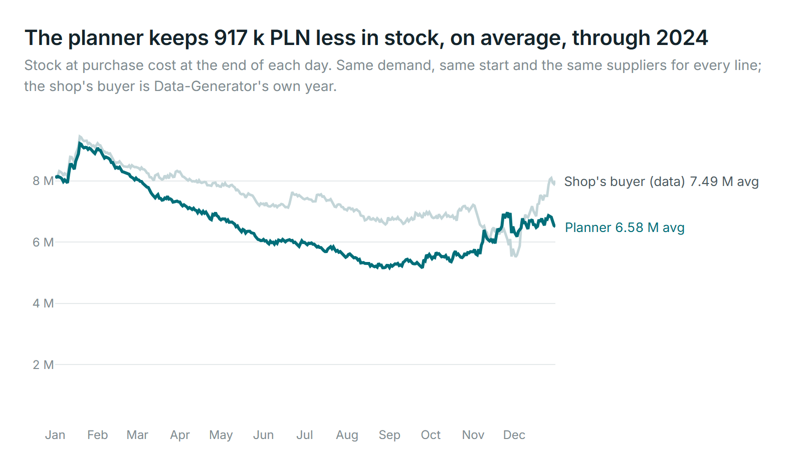
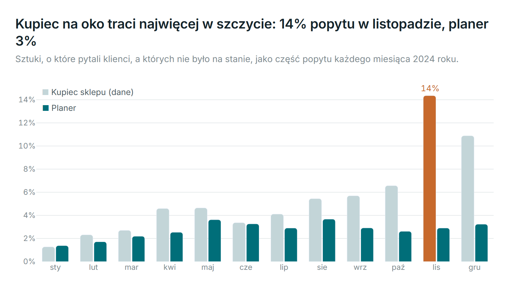
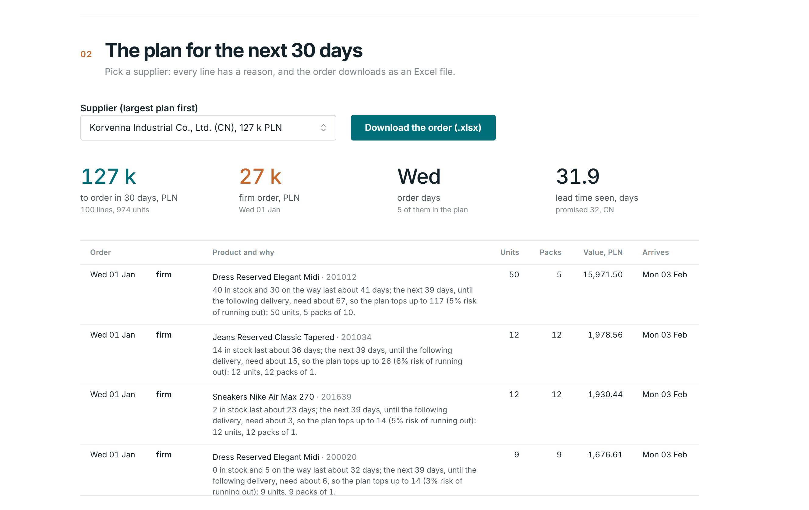
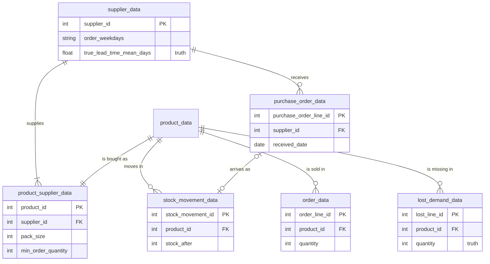

# Purchase Planner

[](https://github.com/tlabedzki/Purchase-Planner/actions/workflows/tests.yml)


[](https://github.com/tlabedzki/Purchase-Planner/releases)
[](READMEPL.md)

A case study and a tool: a 30-day purchase plan for every supplier of Lumo, a fictional online shop, tested on all
of 2024.

**Problem.** The buyer orders by eye: the average sales of the last few weeks, times the lead time, plus a little
extra. At the peak of the season products run out and customers leave with nothing; the rest of the year money sits
in stock that sells slowly. Nobody knows what either mistake costs, because sales lost to an empty shelf show up in
no table.

**Approach.** A forecast of daily demand, the stock on hand and each supplier's lead time become a list of orders
with a reason for every line. A backtest replays all of 2024 on the true demand, including the demand that was lost,
and compares the planner with the shop's buyer.

<!-- generated:result -->
**Result.** Over all of 2024 the planner served 97.2% of demand (the shop's buyer 93.0%) with 917 k PLN less stock on
average (−12%) and 471 k PLN less margin lost (−27%).
<!-- /generated:result -->

<!-- generated:hero -->
<picture>
  <source media="(prefers-color-scheme: dark)" srcset="docs/img/app-demo-dark.svg">
  
</picture>
<!-- /generated:hero -->

**Stack:** Python · pandas · NumPy · SciPy · Dash with Mantine · Plotly · openpyxl · pytest

<!-- generated:summary -->
- **What worked:** in November and December the forecast misses less than the 28-day average (WAPE 0.47 against 0.55),
  and the planner keeps up with Black Friday.
- **What missed:** lost revenue is higher than the buyer's (7.17 M against 5.40 M PLN): the planner lets expensive,
  low-margin products run out more often.
<!-- /generated:summary -->

## 1. The shop, its suppliers and a buyer who orders by eye

Lumo is a fictional online shop with 2,000 products in 15 categories. It buys from 24 suppliers in Poland, Germany
and China. Each supplier takes orders on its own weekdays, delivers in its own time (from a few days to over a month)
and sells in packs with a minimum order. On every order day the shop's buyer looks at the sales of the last 4 weeks.
The project answers the buyer's questions:

| Question | Method and tables | Answer to check against |
|---|---|---|
| How many units of each product will sell in the coming weeks? | Daily forecast: category season × product level (chapter 3) | 2024 demand: `order_data` and `lost_demand_data` |
| How much to order so that nothing runs out and money does not sit on the shelf? | Order-up-to policy with one stock budget (chapter 4) | the backtest on the true 2024 demand |
| Is it better than ordering by eye? | Backtest: 2024 once more (chapter 5) | the buyer's year in `stock_movement_data` and `lost_demand_data` |
| How long does a delivery really take? | Lead times from the order history in `purchase_order_data` | `true_lead_time_mean_days`, `true_lead_time_cv` |
| What to order from each supplier today? | 30-day plan and an Excel order (chapter 6) | the future; chapter 5 tests the same method |

## 2. How we know the truth

The data come from [Data Generator](https://github.com/tlabedzki/Data-Generator) 1.8.0 with stockouts on: when a
product is out of stock the customer cannot buy it and the order line is lost. The generator keeps two things a real
shop does not know, and they are the answer key:

- `lost_demand_data`: every line a customer could not place because the shelf was empty. Sales plus these lines are
  the true demand.
- `true_lead_time_mean_days` and `true_lead_time_cv` in `supplier_data`: the mean lead time and its spread (standard
  deviation over the mean). The shop only sees the dates of its orders and receipts.

The planner reads only the tables every shop has: customer orders, stock movements, purchase orders and the catalog
(`data.load(truth=False)`). Only the backtest reads the truth, to simulate the stock on the true demand. Three
controls check the result:

- **The buyer by eye, rebuilt in the simulator.** The same rule as in Data Generator, run through the simulator, has
  to give the same year as the data. If it does, the simulator counts stock the way the generator does.
- **A perfect forecast.** A planner that knows future demand sets the ceiling: nothing does better with the same
  suppliers.
- **A second shop for tuning.** The planner's settings are chosen on a shop with another random seed (7), and the
  results are reported on seed 42, which the tuning never saw.

## 3. The forecast: how much sells each day?

**Question.** How many units of each product will the shop sell on each of the coming days, Black Friday and the
weeks before Christmas included?

**What we did.** The forecast is the product of two parts. The category season is a Poisson regression (a model of
counts) on the history: month, weekday and the trading days of the calendar, such as Black Friday, Cyber Monday and
Mikołajki (St Nicholas' Day). The product level comes from TSB (Teunter, Syntetos and Babai): it smooths the chance
that a product sells on a day and the size of a sale when it does, separately. It therefore works for best sellers and
for products that sell twice a month. Days that began without stock are skipped, because their sales say nothing about
demand.

**How we check it.** A forecast for every day of 2024, summed by product and week, against the true demand. The
measure is WAPE: the sum of absolute errors over the sum of demand (0 is a perfect forecast). The benchmark is the
average of the last 28 days, the number the buyer looks at.

**Result.**

<!-- generated:forecast -->
On 2024, summed by product and week, the forecast has a WAPE of 0.56 and the 28-day average 0.63; in November and
December 0.47 against 0.55. The forecast adds up to 1.01 of the true demand (1 means no lean either way).
<!-- /generated:forecast -->

**What it means for the buyer.** The gap in error is moderate, because a single product sells irregularly and no
forecast can guess that. Timing matters more for orders: the average of the last weeks does not know Black Friday is
coming, the category season does, so orders grow before the peak instead of after it.

## 4. How much to order: one stock budget instead of fixed levels

**Question.** Up to what level should each product be topped up on the supplier's order day, so that it rarely runs
out and the stock does not grow for nothing?

**What we did.** An order-up-to policy: on each order day the planner estimates the demand until the next delivery
arrives (the lead time plus the days to the next order day) and orders the difference, rounded up to whole packs and
at least the supplier's minimum. The level is a quantile of the demand over that period (a negative binomial
distribution, which describes irregular sales well), plus room for the spread of the lead time. The choice that
matters is which quantile to use for which product. Instead of fixed levels for ABC classes, the planner shares one
stock budget so that every zloty in stock protects as much margin as it can. The risk of running out therefore grows
with the ratio of a unit's cost to its margin, and less with the unit's price itself.

**How we check it.** Tuning on the seed 7 shop: of the settings tried, the one with the lowest average stock wins,
provided it serves at least 96% of demand and loses no more margin than the buyer by eye. The 96% floor is one point
of safety above the 95% goal. The chosen setting goes into the code unchanged.

**Result.**

<!-- generated:allocation -->
The same forecast with fixed ABC levels serves 96.8% of demand but holds 9.21 M PLN of stock on average, more than
buying by eye (7.43 M PLN). With one shared budget: 97.2% on 6.58 M PLN. On the tuning shop (seed 7) the chosen setting
serves 96.8% on 4.68 M PLN of stock; 21 settings were tried and 11 met both conditions.
<!-- /generated:allocation -->

**What it means for the buyer.** Fixed ABC levels give high service but pay for it with stock of expensive products
that rarely sell. A shared budget moves that money to where it keeps more margin.

## 5. Backtest: 2024 once more

**Question.** Had the shop ordered with the planner all through 2024, how much demand would it have served, how much
money would it have kept in stock and how much margin would it have lost?

**What we did.** The simulator starts from the real stock on 1 January 2024 and the purchase orders already on the
way. Every day it receives deliveries, serves customer orders in the order they came while stock lasts, and on the
suppliers' order days asks the policy what to order. Each delivery's lead time is drawn from the supplier's true
distribution, the same draws for every policy. The planner sees only its own simulated sales and stock, as in a real
shop.

**How we check it.** Every policy gets the same demand, the same starting stock and the same suppliers. Demand served
is units sold over units customers asked for. Average stock is the value of goods at purchase cost at the end of each
day, averaged over the year. Lost margin is the revenue without VAT of the lines that were lost, minus their purchase
cost.

**Result.**

<!-- generated:backtest -->
| Policy | Demand served | Average stock, PLN | Lost margin, PLN | Lost revenue, PLN |
|---|---:|---:|---:|---:|
| Shop's buyer (data) | 93.0% | 7.49 M | 1.75 M | 5.40 M |
| Buyer by eye (rebuilt) | 93.6% | 7.43 M | 1.64 M | 5.05 M |
| Planner, fixed ABC service | 96.8% | 9.21 M | 696 k | 2.07 M |
| **Planner** | 97.2% | 6.58 M | 1.28 M | 7.17 M |
| Perfect forecast | 99.4% | 5.56 M | 225 k | 1.14 M |




<!-- /generated:backtest -->

**What it means for the buyer.** The rebuilt buyer by eye matches the buyer's year in the data, so the comparison is
fair. The planner serves more demand with less stock, and it gains the most where the buyer loses the most: in
November and December.

## 6. The plan for the next 30 days

**Question.** What to order from each supplier from the first day after the data ends, and why exactly that much?

**What we did.** The policy tested in chapter 5 computes the plan from 1 January 2025. Each supplier's first order day
is firm, because it rests on the real stock. Later days are projected: stock falls by the forecast and rises with the
deliveries on the way. Every line has a reason in one sentence, and the supplier's order downloads as an Excel file
with a total and number formats. The app (`python -m ui.app`) shows the backtest, the plan of a chosen supplier with
the download button, and one product: its sales, stock, forecast and planned deliveries.

**Result.**

<!-- generated:plan -->
The 30-day plan from 2025-01-01 has 815 lines at 23 suppliers for 555 k PLN; the firm orders (each supplier's first
order day) are 111 lines for 89 k PLN. The largest firm line: Dress Reserved Elegant Midi (Korvenna Industrial Co.,
Ltd.), 50 units: "39 in stock and 30 on the way last about 40 days; the next 39 days, until the following delivery, need
about 67, so the plan tops up to 117 (5% risk of running out): 50 units, 5 packs of 10."


<!-- /generated:plan -->

**What it means for the buyer.** Instead of working out every line, the buyer reads a list with reasons and sends the
supplier a file. The projected lines show what is coming in the next weeks, so large orders from Chinese suppliers
come into view early.

## 7. Analysis against the truth

<!-- generated:verdicts -->
| Criterion | Planner | Verdict |
|---|---|---|
| Demand served at least 95% | 97.2% | yes |
| Average stock below the shop's buyer | 6.58 M against 7.49 M PLN | yes |
| Average stock below buying by eye (rebuilt) | 6.58 M against 7.43 M PLN | yes |
| Lost margin below the shop's buyer | 1.28 M against 1.75 M PLN | yes |
| Lost revenue below the shop's buyer | 7.17 M against 5.40 M PLN | no |
| Close to the perfect forecast (the ceiling) | 97.2% and 6.58 M PLN against 99.4% and 5.56 M PLN | partly |
<!-- /generated:verdicts -->

**Where it went wrong and what it teaches.**

- **The empty-shelf spiral.** The first version counted a day on which a product sold out as a day without an
  observation. Products that sold down to zero had almost no observed sales, the forecast shrank and the planner
  stopped ordering them. Lesson: a day counts by the stock at its start, and selling out is almost all of that day's
  demand.
- **Fixed ABC levels.** The textbook 97/94/85% service by class gave good service but more stock than the buyer by
  eye. Lesson: the level has to depend on a unit's cost and margin, not only on its rank.
- **Lost revenue.** The planner protects margin and lets revenue slip: expensive, low-margin products run out more
  often. A shop that cares about turnover should tune the planner on revenue instead of margin.
- **The distance to the ceiling.** The perfect forecast serves more with less stock. The gap is the noise in the
  sales of single products, which a forecast from history cannot remove.

Misses shown openly are a strength here: the true demand and the buyer's year are in the data, so the grading can
say "no", and a "yes" in the table means something.

## 8. Takeaways and limitations

**Recommendations.**

1. Order from a forecast with the season, not from the average of the last weeks, at least before Black Friday and
   Christmas.
2. Share one stock budget by margin per zloty instead of keeping fixed ABC levels.
3. Plan Chinese suppliers a full lead time ahead: the 30-day plan shows them early.
4. Treat days without stock separately, or the forecast and the orders shrink on their own.

**Limitations.**

- The data are synthetic: demand does not depend on whether the product was in stock on earlier days, and customers
  do not pick a substitute.
- The result comes from one shop (seed 42), and the settings from another (seed 7). Another shop gives other numbers.
- Returns go to an outlet and do not come back into stock, and cancelled orders keep their units (a simplification of
  Data Generator). One warehouse, no budget cap and no quantity discounts.
- The planner knows the products' withdrawal dates from the catalog (so does the buyer by eye) and weights the budget
  with the current list price. A shop knows its own withdrawal plans, and a check without them moved the average stock
  by 0.2%.
- A real shop has no `lost_demand_data`. The planner does not need it, but a backtest would have to estimate the lost
  demand from the days without stock.

## Quickstart

You need Git and Python 3.11. Clone the repository:

```bash
git clone https://github.com/tlabedzki/Purchase-Planner.git
cd Purchase-Planner
```

<details><summary>Create and activate a virtual environment with Python 3.11 (Windows, macOS and Linux)</summary>

Naming the version picks Python 3.11 even if another one is the default.

| Step | Windows (PowerShell) | macOS and Linux |
|---|---|---|
| Create | `py -3.11 -m venv .venv` | `python3.11 -m venv .venv` |
| Activate | `.venv\Scripts\Activate.ps1` | `source .venv/bin/activate` |
| Check | `python --version` prints `Python 3.11.x` | `python --version` prints `Python 3.11.x` |

If PowerShell says that running scripts is disabled, run `Set-ExecutionPolicy -Scope CurrentUser RemoteSigned` once
and activate again.

</details>

Then install the packages, get the data and start:

```bash
pip install -r requirements.txt
python scripts/get_data.py
python main.py
```

`get_data.py` clones Data Generator 1.8.0 and generates the shop with seeds 42 and 7 into `data/raw/` (about a
minute). `main.py` prints the backtest and the plan in about 11 seconds and writes `plan.csv` and an Excel order per
supplier to `output/`. `python main.py --check` checks the criteria of chapter 7.

### App

`python -m ui.app` computes the backtest and the plan (about 10 seconds) and opens the app at http://127.0.0.1:8050.
Stop it with Ctrl+C.

## Data

Every product, customer, order, supplier and delivery is synthetic: Data Generator 1.8.0 (MIT license) generates them
with this project's settings: 2021-2024, 2,000 products, 200,000 customers, 400,000 order lines and stockouts on
(`stockouts`). The generator's code is unchanged. Brand names are only labels, and the supplier names are made up.
The test sample in `data/sample/` (3 suppliers, 2023-2024) is a cut of these tables (`scripts/make_sample.py`).



Every column is described in
[Data Generator's docs/columns.md](https://github.com/tlabedzki/Data-Generator/blob/main/docs/columns.md).

## Why these tools

The project reads 7 Data Generator tables from Parquet files (about 18 MB per shop) once per run, in one process,
and keeps them in memory as days × products arrays. A fresh clone rebuilds everything without a server, account, key
or paid service: `get_data.py` fetches the public Data Generator and Python computes the rest.

| Tool | What it does here and why it fits | Alternative considered |
|---|---|---|
| NumPy | The TSB forecast and the ordering policy run vectorized over 2,000 products; updating the forecast by one day takes 0.13 ms, so the backtest refreshes it every day without waiting. | statsforecast: TSB for every product in 0.11 s, but from scratch on every day of the year, about 40 s per policy and a quarter of an hour for the tuning. |
| SciPy | Quantiles of the Poisson and negative binomial distributions, which describe the irregular sales of single products well. | The normal approximation: with expected sales below one unit it would order stock nobody needs. |
| pandas | Reads the Parquet tables and builds the history, the plan and the result tables; the standard for data work in Python. | – |
| Dash with Mantine, Plotly | The shared look of the portfolio apps, matching Data Generator; the same Plotly figures go into the app and the README. | Streamlit: dropped for the whole portfolio, because beyond colours and font it keeps its own layout. |
| openpyxl | The supplier's order as an Excel file with a coloured header, number formats and a total row computed by a formula. | CSV: carries no formats and no total. |
| pytest, ruff | Tests on the data sample in the repository (no network) and linting on every push in CI. | – |

## Project structure

<details><summary>Show the tree</summary>

```
main.py                    backtest result, plan, --check and --tune
src/purchase_planner/      data, history, calendar, forecast, policies, backtest, plan, export, report
ui/                        Dash app with Mantine
scripts/                   data download, sample, README charts, screenshots and the app demo
data/sample/               a cut of the data for the tests
docs/img/                  charts and screenshots for the README
tests/                     pytest tests
```

</details>

## Tests

```bash
pip install -r requirements-dev.txt
python -m pytest
```

30 tests (about 4 seconds) on the sample in the repository check the calendar, the regression and TSB, the quantiles,
packs and minimums, the consistency of the history, the demand balance of the backtest, reproducibility, the plan,
the Excel file and the app.

## License

MIT, see [LICENSE](LICENSE). [Changelog](CHANGELOG.md).

README last updated: 2026-11-27
