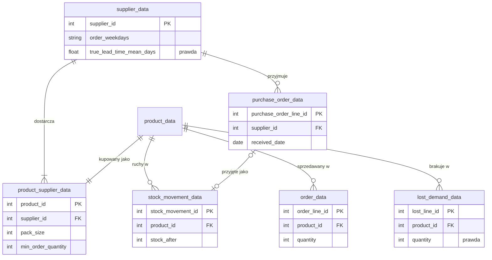

# Purchase Planner

[](https://github.com/tlabedzki/Purchase-Planner/actions/workflows/tests.yml)


Studium przypadku i narzędzie: plan zakupów na 30 dni dla każdego dostawcy fikcyjnego sklepu Lumo, sprawdzony na całym
2024 roku.

**Problem.** Kupiec zamawia na oko: bierze średnią sprzedaż z ostatnich tygodni, mnoży przez czas dostawy i dokłada
trochę zapasu. W szczycie sezonu towar się kończy i klienci odchodzą z niczym, a przez resztę roku w magazynie leżą
pieniądze w towarze, który schodzi powoli. Nikt nie wie, ile kosztuje każda z tych pomyłek, bo sprzedaży utraconej
przez pustą półkę nie widać w żadnej tabeli.

**Podejście.** Prognoza dziennego popytu, stan magazynu i czas dostawy każdego dostawcy składają się na listę zamówień
z powodem przy każdej pozycji. Test wsteczny odtwarza cały 2024 rok na prawdziwym popycie, także tym utraconym,
i porównuje planer z kupcem sklepu.

<!-- generated:result -->
**Wynik.** Na całym 2024 roku planer obsłużył 97,2% popytu (kupiec sklepu 93,0%), trzymając średnio o 917 tys. zł mniej
w magazynie (−12%) i tracąc o 471 tys. zł mniej marży (−27%).
<!-- /generated:result -->

<!-- generated:hero -->
<picture>
  <source media="(prefers-color-scheme: dark)" srcset="docs/img/app-demo-dark.svg">
  
</picture>
<!-- /generated:hero -->

**Stack:** Python · pandas · NumPy · SciPy · Dash z Mantine · Plotly · openpyxl · pytest

<!-- generated:summary -->
- **Trafione:** w listopadzie i grudniu prognoza myli się mniej niż średnia z 28 dni (WAPE 0,47 wobec 0,55), a planer
  nie gubi szczytu Black Friday.
- **Chybione:** utracony przychód jest wyższy niż u kupca (7,17 mln wobec 5,40 mln zł), bo planer częściej odpuszcza
  drogie produkty z niską marżą.
<!-- /generated:summary -->

## 1. Sklep, dostawcy i kupiec, który zamawia na oko

Lumo to fikcyjny sklep internetowy z 2000 produktów w 15 kategoriach. Towar kupuje u 24 dostawców z Polski, Niemiec
i Chin. Każdy dostawca przyjmuje zamówienia w swoje dni tygodnia, dostarcza w swoim czasie (od kilku dni do ponad
miesiąca) i sprzedaje w opakowaniach z minimum zamówienia. W każdy dzień zamówień kupiec sklepu patrzy na sprzedaż
z ostatnich 4 tygodni. Projekt odpowiada na jego pytania:

| Pytanie | Jak odpowiada analiza | Gdzie leży prawdziwa odpowiedź |
|---|---|---|
| Ile sztuk każdego produktu zejdzie w najbliższych tygodniach? | Prognoza dzienna: sezon kategorii × poziom produktu (rozdział 3) | popyt 2024: `order_data` i `lost_demand_data` |
| Ile zamówić, żeby nie zabrakło, a pieniądze nie leżały w magazynie? | Polityka „zamów do poziomu” z jednym budżetem zapasu (rozdział 4) | test wsteczny na prawdziwym popycie 2024 |
| Czy to lepsze niż zamawianie na oko? | Test wsteczny: 2024 rok jeszcze raz (rozdział 5) | rok kupca w `stock_movement_data` i `lost_demand_data` |
| Jak długo naprawdę jedzie dostawa? | Czasy dostaw z historii zamówień w `purchase_order_data` | `true_lead_time_mean_days`, `true_lead_time_cv` |
| Co dziś zamówić u każdego dostawcy? | Plan na 30 dni i zamówienie w Excelu (rozdział 6) | przyszłość; tę samą metodę sprawdza rozdział 5 |

## 2. Skąd wiadomo, co jest prawdą

Dane pochodzą z [Data-Generatora](https://github.com/tlabedzki/Data-Generator) 1.8.0 z włączonymi brakami towaru:
gdy produktu nie ma na stanie, klient go nie kupi, a linia zamówienia przepada. Generator zapisuje dwie rzeczy, których
prawdziwy sklep nie zna, i to one są kluczem odpowiedzi:

- `lost_demand_data`: każda linia, której klient nie mógł złożyć, bo półka była pusta. Sprzedaż plus te linie to
  prawdziwy popyt.
- `true_lead_time_mean_days` i `true_lead_time_cv` w `supplier_data`: średni czas dostawy i jego rozrzut (odchylenie
  standardowe przez średnią). Sklep widzi tylko daty swoich zamówień i przyjęć.

Planer czyta wyłącznie tabele, które ma każdy sklep: zamówienia klientów, ruchy magazynu, zamówienia do dostawców
i katalog (`data.load(truth=False)`). Prawdę czyta tylko test wsteczny, który symuluje magazyn na prawdziwym popycie.
Wynik sprawdzają trzy kontrole:

- **Kupiec na oko odtworzony w symulatorze.** Ta sama reguła co w Data-Generatorze, puszczona przez symulator, ma dać
  ten sam rok co dane. Jeśli daje, symulator liczy magazyn tak samo jak generator.
- **Prognoza idealna.** Planer, który zna przyszły popyt, wyznacza sufit: lepiej się nie da przy tych samych
  dostawcach.
- **Drugi sklep do strojenia.** Ustawienia planera wybieram na sklepie z innym ziarnem losowania (seed 7), a wyniki
  podaję na seed 42, którego strojenie nie widziało.

## 3. Prognoza: ile sprzeda się każdego dnia?

**Pytanie.** Ile sztuk każdego produktu sklep sprzeda w każdym z najbliższych dni, także w Black Friday i przed
świętami?

**Co robi analiza.** Prognoza to iloczyn dwóch części. Sezon kategorii to regresja Poissona (model liczby zdarzeń)
na historii: miesiąc, dzień tygodnia i dni handlowe z kalendarza, na przykład Black Friday, Cyber Monday i Mikołajki.
Poziom produktu daje metoda TSB (Teunter, Syntetos i Babai): osobno wygładza szansę, że produkt sprzeda się danego dnia,
i wielkość sprzedaży, gdy się sprzeda. Dlatego działa i dla hitów, i dla produktów, które schodzą dwa razy w miesiącu.
Dni, które zaczęły się bez towaru, prognoza pomija, bo ich sprzedaż nie mówi nic o popycie.

**Jak to sprawdzamy.** Prognoza na każdy dzień 2024 roku, zsumowana po produktach i tygodniach, porównana z prawdziwym
popytem. Miarą jest WAPE: suma błędów bez znaku przez sumę popytu (0 to prognoza bez błędu). Punktem odniesienia jest
średnia z ostatnich 28 dni, czyli to, na co patrzy kupiec.

**Wynik.**

<!-- generated:forecast -->
Na 2024 roku, w sumach tygodniowych na produkt, błąd WAPE prognozy wynosi 0,56, a średniej z 28 dni 0,63; w listopadzie
i grudniu 0,47 wobec 0,55. Suma prognozy to 1,01 prawdziwego popytu (1 to brak przechyłu).
<!-- /generated:forecast -->

**Co to znaczy dla kupca.** Różnica w błędzie jest umiarkowana, bo pojedynczy produkt sprzedaje się nieregularnie
i tego żadna prognoza nie zgadnie. Dla zamówień ważniejszy jest moment: średnia z ostatnich tygodni nie wie, że
nadchodzi Black Friday, a sezon kategorii wie, więc zamówienia rosną przed szczytem, a nie po nim.

## 4. Ile zamówić: jeden budżet zapasu zamiast stałych progów

**Pytanie.** Do jakiego poziomu uzupełniać każdy produkt w dzień zamówień dostawcy, żeby rzadko brakowało towaru,
a zapas nie rósł bez potrzeby?

**Co robi analiza.** Polityka „zamów do poziomu”: w każdy dzień zamówień planer liczy popyt do przyjazdu następnej
dostawy (czas dostawy plus dni do kolejnego dnia zamówień) i zamawia brakującą różnicę, zaokrągloną do pełnych
opakowań i co najmniej do minimum dostawcy. Poziom to kwantyl popytu w tym okresie (rozkład ujemny dwumianowy, który
dobrze opisuje nieregularną sprzedaż), z dodatkiem na rozrzut czasu dostawy. Kluczowe jest, jaki kwantyl wybrać dla
którego produktu. Zamiast stałych progów dla klas ABC planer dzieli jeden budżet zapasu tak, żeby każda złotówka
w magazynie chroniła jak najwięcej marży. Ryzyko braku rośnie więc ze stosunkiem kosztu sztuki do jej marży i słabiej
z samą ceną sztuki.

**Jak to sprawdzamy.** Strojenie na sklepie z seed 7: spośród sprawdzonych ustawień wygrywa to z najmniejszym
średnim zapasem, które obsługuje co najmniej 96% popytu i nie traci więcej marży niż kupiec na oko. Próg 96% to
jeden punkt zapasu bezpieczeństwa ponad celem 95%. Wybrane ustawienie wchodzi do kodu bez zmian.

**Wynik.**

<!-- generated:allocation -->
Ta sama prognoza ze stałymi progami ABC obsługuje 96,8% popytu, ale trzyma średnio 9,21 mln zł zapasu, więcej niż kupiec
na oko (7,43 mln zł). Z przydziałem jednego budżetu: 97,2% przy 6,58 mln zł. Na sklepie do strojenia (seed 7) wybrane
ustawienie daje 96,8% obsługi i 4,68 mln zł zapasu; sprawdzono 21 ustawień, 11 spełniło oba warunki.
<!-- /generated:allocation -->

**Co to znaczy dla kupca.** Stałe progi ABC dają wysoką obsługę, ale płacą za nią zapasem drogich produktów, które
rzadko schodzą. Wspólny budżet przesuwa te pieniądze tam, gdzie zatrzymują więcej marży.

## 5. Test wsteczny: 2024 rok jeszcze raz

**Pytanie.** Gdyby sklep zamawiał według planera przez cały 2024 rok, ile popytu by obsłużył, ile pieniędzy trzymałby
w magazynie i ile marży by stracił?

**Co robi analiza.** Symulator startuje z prawdziwego stanu magazynu na 1 stycznia 2024 i z zamówień, które już były
w drodze. Każdego dnia przyjmuje dostawy, obsługuje zamówienia klientów w kolejności złożenia, dopóki starcza towaru,
a w dni zamówień dostawców pyta politykę, co zamówić. Czas każdej dostawy losuje z prawdziwego rozkładu dostawcy.
Planer widzi tylko własną symulowaną sprzedaż i stan, jak w prawdziwym sklepie.

**Jak to sprawdzamy.** Wszystkie polityki dostają ten sam popyt, ten sam stan na start i tych samych dostawców.
Obsłużony popyt to sprzedane sztuki przez sztuki, o które pytali klienci. Średni zapas to wartość towaru po cenie
zakupu na koniec dnia, uśredniona po roku. Utracona marża to przychód bez VAT z linii, które przepadły, minus ich koszt
zakupu.

**Wynik.**

<!-- generated:backtest -->
| Polityka | Obsłużony popyt | Średni zapas, zł | Utracona marża, zł | Utracony przychód, zł |
|---|---:|---:|---:|---:|
| Kupiec sklepu (dane) | 93,0% | 7,49 mln | 1,75 mln | 5,40 mln |
| Kupiec na oko (odtworzony) | 93,6% | 7,43 mln | 1,64 mln | 5,05 mln |
| Planer, stałe progi ABC | 96,8% | 9,21 mln | 696 tys. | 2,07 mln |
| **Planer** | 97,2% | 6,58 mln | 1,28 mln | 7,17 mln |
| Prognoza idealna | 99,4% | 5,56 mln | 225 tys. | 1,14 mln |


<!-- /generated:backtest -->

**Co to znaczy dla kupca.** Odtworzony kupiec na oko trafia w rok kupca z danych, więc porównanie jest uczciwe.
Planer obsługuje więcej popytu przy mniejszym zapasie, a najwięcej zyskuje tam, gdzie kupiec traci najwięcej:
w listopadzie i grudniu.

## 6. Plan na najbliższe 30 dni

**Pytanie.** Co zamówić u każdego dostawcy od pierwszego dnia po końcu danych i dlaczego właśnie tyle?

**Co robi analiza.** Ta sama polityka, którą sprawdził rozdział 5, liczy plan od 1 stycznia 2025. Pierwszy dzień
zamówień każdego dostawcy jest pewny, bo opiera się na prawdziwym stanie. Kolejne dni są przewidywane: stan spada
o prognozę i rośnie o dostawy w drodze. Każda linia ma powód zdaniem, a zamówienie dostawcy pobiera się jako plik
Excela z sumą i formatami. Aplikacja (`python -m ui.app`) pokazuje test wsteczny, plan wybranego dostawcy z przyciskiem
pobrania oraz produkt: sprzedaż, stan, prognozę i planowane dostawy.

**Wynik.**

<!-- generated:plan -->
Plan na 30 dni od 01.01.2025 ma 815 linii u 23 dostawców na 555 tys. zł; zamówienia pewne (pierwszy dzień zamówień
każdego dostawcy) to 111 linii na 89 tys. zł. Największa pozycja pewna: Dress Reserved Elegant Midi (Korvenna Industrial
Co., Ltd.), 50 szt., z powodem w aplikacji (po angielsku): „39 in stock and 30 on the way last about 40 days; the next
39 days, until the following delivery, need about 67, so the plan tops up to 117 (5% risk of running out): 50 units, 5
packs of 10.”


<!-- /generated:plan -->

**Co to znaczy dla kupca.** Zamiast liczyć każdą pozycję, kupiec przegląda listę z powodami i wysyła dostawcy plik.
Pozycje przewidywane mówią, co nadejdzie w kolejnych tygodniach, więc wcześniej widać duże zamówienia u dostawców
z Chin.

## 7. Analiza kontra prawda

<!-- generated:verdicts -->
| Kryterium | Planer | Ocena |
|---|---|---|
| Obsłużony popyt co najmniej 95% | 97,2% | tak |
| Średni zapas niższy niż u kupca sklepu | 6,58 mln wobec 7,49 mln zł | tak |
| Średni zapas niższy niż u kupca na oko (odtworzonego) | 6,58 mln wobec 7,43 mln zł | tak |
| Utracona marża niższa niż u kupca sklepu | 1,28 mln wobec 1,75 mln zł | tak |
| Utracony przychód niższy niż u kupca sklepu | 7,17 mln wobec 5,40 mln zł | nie |
| Blisko prognozy idealnej (sufit) | 97,2% i 6,58 mln zł wobec 99,4% i 5,56 mln zł | częściowo |
<!-- /generated:verdicts -->

**Gdzie metody się pomyliły i czego to uczy.**

- **Spirala pustej półki.** Pierwsza wersja liczyła dzień, w którym towar się skończył, jako dzień bez obserwacji.
  Produkty, które schodziły do zera, prawie nie miały obserwowanej sprzedaży, prognoza malała i planer przestawał je
  zamawiać. Lekcja: dzień liczy się według stanu na jego początku, a sprzedaż do zera to prawie cały popyt tego dnia.
- **Stałe progi ABC.** Podręcznikowe 97/94/85% obsługi według klas dało dobrą obsługę, ale zapas większy niż u kupca
  na oko. Lekcja: próg trzeba wiązać z kosztem i marżą sztuki, a nie tylko z jej miejscem w rankingu.
- **Utracony przychód.** Planer oszczędza marżę, a nie przychód: częściej odpuszcza drogie produkty z niską marżą.
  Sklep, któremu zależy na obrocie, powinien stroić planer na przychodzie, a nie na marży.
- **Odległość od sufitu.** Prognoza idealna obsługuje więcej przy mniejszym zapasie. Różnica to szum sprzedaży
  pojedynczych produktów, którego prognoza z historii nie usunie.

Pomyłki pokazane wprost są tu wartością: prawdziwy popyt i rok kupca są zapisane w danych, więc ocena może powiedzieć
„nie”, a „tak” w tabeli coś znaczy.

## 8. Wnioski i ograniczenia

**Rekomendacje.**

1. Zamawiać według prognozy z sezonem, a nie średniej z ostatnich tygodni, przynajmniej przed Black Friday i świętami.
2. Dzielić jeden budżet zapasu według marży na złotówkę zamiast trzymać stałe progi ABC.
3. Przy produktach z Chin planować z wyprzedzeniem całego czasu dostawy: plan na 30 dni pokazuje je wcześniej.
4. Liczyć dni bez towaru osobno, bo inaczej prognoza i zamówienia spadają same z siebie.

**Ograniczenia.**

- Dane są syntetyczne: popyt nie zależy od tego, czy towar był na stanie w poprzednich dniach, a klient nie wybiera
  zamiennika.
- Wynik pochodzi z jednego sklepu (seed 42), a ustawienia z drugiego (seed 7). Inny sklep da inne liczby.
- Zwroty trafiają do outletu i nie wracają na stan, a anulowane zamówienia nie oddają towaru (uproszczenie
  Data-Generatora). Jeden magazyn, bez limitu budżetu i rabatów ilościowych.
- Planer zna z katalogu daty wycofania produktów (kupiec na oko też), a wagi budżetu liczy z bieżącej ceny katalogowej.
  Sklep zna swoje plany wycofania, a sprawdzenie bez tej wiedzy zmieniło średni zapas o 0,2%.
- W prawdziwym sklepie nie ma `lost_demand_data`. Planer go nie potrzebuje, ale test wsteczny musiałby oszacować
  utracony popyt z dni bez towaru.

## Szybki start

Potrzebujesz Gita i Pythona 3.11. Sklonuj repozytorium:

```bash
git clone https://github.com/tlabedzki/Purchase-Planner.git
cd Purchase-Planner
```

<details><summary>Utwórz i włącz środowisko wirtualne z Pythonem 3.11 (Windows, macOS i Linux)</summary>

Podanie wersji wybiera Pythona 3.11, nawet jeśli domyślny jest inny.

| Krok | Windows (PowerShell) | macOS i Linux |
|---|---|---|
| Utwórz | `py -3.11 -m venv .venv` | `python3.11 -m venv .venv` |
| Włącz | `.venv\Scripts\Activate.ps1` | `source .venv/bin/activate` |
| Sprawdź | `python --version` pokazuje `Python 3.11.x` | `python --version` pokazuje `Python 3.11.x` |

Jeśli PowerShell mówi, że uruchamianie skryptów jest wyłączone, uruchom raz
`Set-ExecutionPolicy -Scope CurrentUser RemoteSigned` i włącz środowisko jeszcze raz.

</details>

Potem zainstaluj pakiety, pobierz dane i uruchom:

```bash
pip install -r requirements.txt
python scripts/get_data.py
python main.py
```

`get_data.py` klonuje Data-Generator 1.8.0 i generuje sklep z seed 42 i 7 do `data/raw/` (około minuty).
`main.py` w około 11 sekund wypisuje wynik testu wstecznego i plan, a do `output/` zapisuje `plan.csv` i zamówienia
w Excelu dla każdego dostawcy. `python main.py --check` sprawdza kryteria z rozdziału 7.

### Aplikacja

`python -m ui.app` liczy test wsteczny i plan (około 10 sekund) i otwiera aplikację pod adresem http://127.0.0.1:8050.
Zatrzymujesz ją przez Ctrl+C.

## Dane

Wszystkie produkty, klienci, zamówienia, dostawcy i dostawy są syntetyczne: generuje je
[Data-Generator](https://github.com/tlabedzki/Data-Generator) 1.8.0 (licencja MIT) z ustawieniami tego projektu: lata
2021–2024, 2000 produktów, 200 000 klientów, 400 000 linii zamówień i włączone braki towaru (`stockouts`). Kod
generatora jest bez zmian. Nazwy marek służą tylko za etykiety, a nazwy dostawców są wymyślone. Próbka do testów
w `data/sample/` (3 dostawców, 2023–2024) to wycinek tych tabel (`scripts/make_sample.py`).



Opis wszystkich kolumn: [docs/columns.md w Data-Generatorze](https://github.com/tlabedzki/Data-Generator/blob/main/docs/columns.md).

## Dlaczego te technologie

Projekt czyta 7 tabel Data-Generatora z plików Parquet (około 18 MB na sklep) raz na uruchomienie, w jednym procesie,
i trzyma je w pamięci jako tablice dni × produkty. Świeży klon odtwarza wszystko bez serwera, konta, klucza i płatnej
usługi: `get_data.py` pobiera publiczny Data-Generator, a resztę liczy Python.

| Narzędzie | Co robi w projekcie i dlaczego pasuje | Rozważona alternatywa |
|---|---|---|
| NumPy | Prognoza TSB i polityka zamówień liczą się wektorowo dla 2000 produktów; aktualizacja prognozy o jeden dzień trwa 0,13 ms, więc test wsteczny przelicza ją codziennie bez czekania. | statsforecast: TSB dla wszystkich produktów w 0,11 s, ale od nowa w każdy dzień roku, czyli około 40 s na politykę i kwadrans na strojenie. |
| SciPy | Kwantyle rozkładu Poissona i ujemnego dwumianowego, które dobrze opisują rzadką sprzedaż pojedynczych produktów. | Przybliżenie normalne: przy oczekiwanej sprzedaży poniżej jednej sztuki kazałoby zamawiać na zapas. |
| pandas | Czyta tabele z Parquet i składa z nich historię, plan i tabele wyników; to standard pracy z danymi w Pythonie. | – |
| Dash z Mantine, Plotly | Wspólny wygląd aplikacji portfolio, zgodny z Data-Generatorem; te same wykresy Plotly trafiają do aplikacji i do README. | Streamlit: odpadł dla całego portfolio, bo poza kolorami i krojem zostaje przy własnym układzie. |
| openpyxl | Zamówienie dostawcy jako plik Excela z kolorem nagłówka, formatami liczb i wierszem sumy liczonym wzorem. | CSV: nie przenosi formatów ani sumy. |
| pytest, ruff | Testy na próbce danych w repo (bez sieci) i lint przy każdym pushu w CI. | – |

## Struktura projektu

<details><summary>Pokaż drzewo</summary>

```
main.py                    wynik testu wstecznego, plan, --check i --tune
src/purchase_planner/      dane, historia, kalendarz, prognoza, polityki, test wsteczny, plan, eksport, raport
ui/                        aplikacja Dash z Mantine
scripts/                   pobranie danych, próbka, wykresy README, zrzuty i animacja aplikacji
data/sample/               wycinek danych do testów
docs/img/                  wykresy i zrzuty do README
tests/                     testy pytest
```

</details>

## Testy

```bash
pip install -r requirements-dev.txt
python -m pytest
```

30 testów (około 4 sekund) na próbce w repo sprawdza kalendarz, regresję i TSB, kwantyle, opakowania i minimum,
spójność historii, bilans popytu w teście wstecznym, powtarzalność, plan, plik Excela i aplikację.

## Licencja

MIT, zob. [LICENSE](LICENSE). [Changelog](CHANGELOG.md).

Ostatnia aktualizacja README: 2026-11-27
