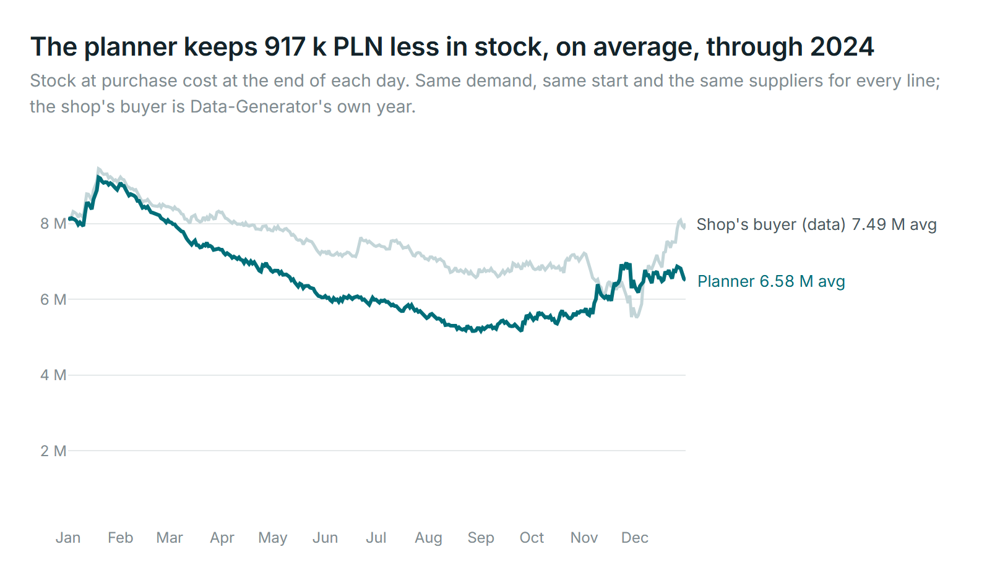
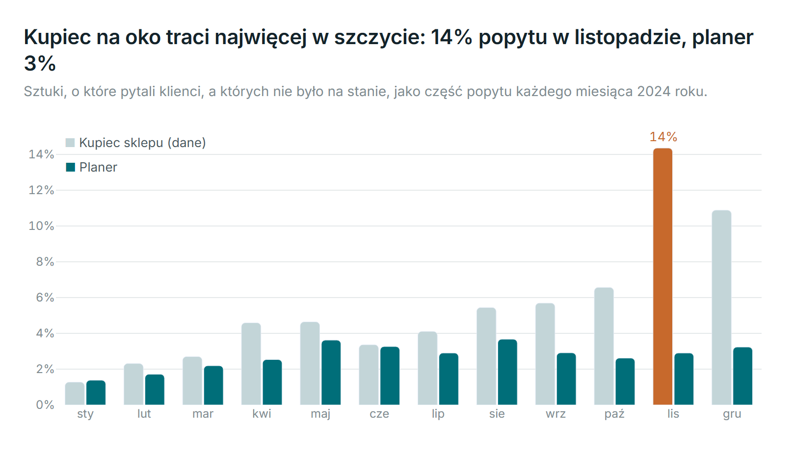
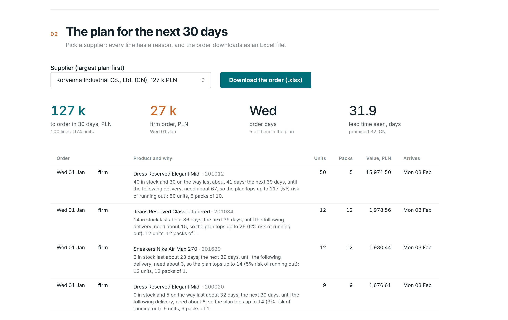
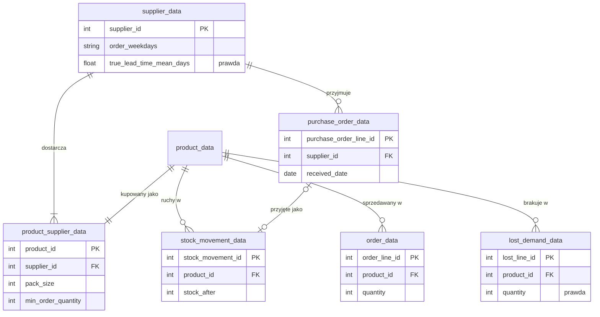

# Purchase Planner

[English](README.md) | **Polski**

[](https://github.com/tlabedzki/Purchase-Planner/actions/workflows/tests.yml)


[](https://github.com/tlabedzki/Purchase-Planner/releases)

Studium przypadku i narzędzie: plan zakupów na 30 dni dla każdego dostawcy Lumo, fikcyjnego sklepu internetowego,
sprawdzony na danych z całego 2024 roku.

**Problem.** Kupiec zamawia na oko: bierze średnią sprzedaż z ostatnich tygodni, mnoży ją przez czas dostawy i dokłada
trochę zapasu. W szczycie sezonu towar się kończy i klienci odchodzą z niczym. Przez resztę roku pieniądze leżą
w magazynie w towarze, który schodzi powoli. Nikt nie wie, ile kosztuje każda z tych pomyłek, bo sprzedaży utraconej
przez pustą półkę nie widać w żadnej tabeli.

**Podejście.** Prognoza dziennego popytu, stan magazynu i czas dostawy każdego dostawcy składają się na listę zamówień
z powodem przy każdej pozycji. Test wsteczny (backtest) to powtórka minionego roku dzień po dniu z nowym sposobem
zamawiania. Odtwarza cały 2024 rok na prawdziwym popycie, także tym utraconym, a potem porównuje planer z kupcem
sklepu.

<!-- generated:result -->
**Wynik.** W całym 2024 roku planer obsłużył 97,2% popytu (kupiec sklepu 93,0%). Średni zapas był przy tym o 917 tys. zł
niższy (−12%), a utracona marża o 471 tys. zł mniejsza (−27%).
<!-- /generated:result -->

<!-- generated:hero -->
<picture>
  <source media="(prefers-color-scheme: dark)" srcset="docs/img/app-demo-dark.svg">
  
</picture>
<!-- /generated:hero -->

**Stack:** Python · pandas · NumPy · SciPy · Dash with Mantine · Plotly · openpyxl · pytest

<!-- generated:summary -->
- **Trafione:** w listopadzie i grudniu prognoza myli się mniej niż średnia z 28 dni (WAPE 0,47 wobec 0,55), a planer
  nadąża za szczytem Black Friday.
- **Chybione:** utracony przychód jest wyższy niż u kupca (7,17 mln wobec 5,40 mln zł), bo u planera częściej brakuje
  drogich produktów z niską marżą.
<!-- /generated:summary -->

## 1. Sklep, dostawcy i kupiec, który zamawia na oko

Lumo to fikcyjny sklep internetowy z 2000 produktów w 15 kategoriach. Towar kupuje u 24 dostawców z Polski, Niemiec
i Chin. Każdy dostawca przyjmuje zamówienia w swoje dni tygodnia i dostarcza w swoim czasie (od kilku dni do ponad
miesiąca). Sprzedaje w opakowaniach zbiorczych i z minimalną wielkością zamówienia. W każdy dzień zamówień kupiec
sklepu patrzy na sprzedaż z ostatnich 4 tygodni. Projekt odpowiada na jego pytania:

| Pytanie | Jak odpowiada analiza | Gdzie leży prawdziwa odpowiedź |
|---|---|---|
| Ile sztuk każdego produktu zejdzie w najbliższych tygodniach? | Prognoza dzienna: sezon kategorii × poziom produktu (rozdział 3) | popyt 2024: `order_data` i `lost_demand_data` |
| Ile zamówić, żeby towaru nie zabrakło, a pieniądze nie leżały na półce? | Polityka „zamów do poziomu” z jednym budżetem zapasu (rozdział 4) | test wsteczny na prawdziwym popycie 2024 |
| Czy to lepsze niż zamawianie na oko? | Test wsteczny: 2024 rok jeszcze raz (rozdział 5) | rok kupca w `stock_movement_data` i `lost_demand_data` |
| Jak długo naprawdę jedzie dostawa? | Czasy dostaw z historii zamówień w `purchase_order_data` | `true_lead_time_mean_days`, `true_lead_time_cv` |
| Co dziś zamówić u każdego dostawcy? | Plan na 30 dni i zamówienie w Excelu (rozdział 6) | przyszłość; tę samą metodę sprawdza rozdział 5 |

## 2. Skąd wiadomo, co jest prawdą

Dane pochodzą z [Data Generatora](https://github.com/tlabedzki/Data-Generator) 1.8.0 z włączonymi brakami towaru
(stockouts): gdy produktu nie ma na stanie, klient nie może go kupić, a linia zamówienia przepada. Generator zapisuje
dwie rzeczy, których prawdziwy sklep nie zna. To one są kluczem odpowiedzi:

- `lost_demand_data`: każda linia, której klient nie mógł złożyć, bo półka była pusta. Sprzedaż razem z tymi liniami
  to prawdziwy popyt.
- `true_lead_time_mean_days` i `true_lead_time_cv` w `supplier_data`: średni czas dostawy (lead time), czyli liczba dni
  od zamówienia do przyjęcia towaru, oraz jego rozrzut (odchylenie standardowe podzielone przez średnią). Sklep widzi
  tylko daty swoich zamówień i przyjęć.

Planer czyta wyłącznie tabele, które ma każdy sklep: zamówienia klientów, ruchy magazynowe, zamówienia do dostawców
oraz katalog (`data.load(truth=False)`). Prawdę czyta tylko test wsteczny, żeby symulować magazyn na prawdziwym
popycie. Wynik sprawdzają trzy kontrole:

- **Kupiec na oko odtworzony w symulatorze.** Ta sama reguła co w Data Generatorze, uruchomiona w symulatorze, musi dać
  ten sam rok co dane. Jeśli daje, symulator liczy magazyn tak samo jak generator.
- **Prognoza idealna.** Planer, który zna przyszły popyt, wyznacza sufit: przy tych samych dostawcach nie da się
  lepiej.
- **Drugi sklep do strojenia.** Ustawienia planera dobrano na danych sklepu z innym ziarnem losowania (seed 7),
  czyli z innym zestawem wylosowanych danych. Wyniki podajemy na seed 42, którego strojenie nie widziało.

## 3. Prognoza: ile sprzeda się każdego dnia?

**Pytanie.** Ile sztuk każdego produktu sklep sprzeda w każdym z najbliższych dni, łącznie z Black Friday i tygodniami
przed świętami?

**Co robi analiza.** Prognoza to iloczyn dwóch części. Sezon kategorii to regresja Poissona (model liczby zdarzeń, tu
sprzedanych sztuk) dopasowana do historii. Uwzględnia miesiąc, dzień tygodnia i dni handlowe z kalendarza, takie jak
Black Friday, Cyber Monday i Mikołajki. Poziom produktu daje metoda TSB (od nazwisk Teunter, Syntetos i Babai). Osobno
wygładza ona szansę, że produkt sprzeda się danego dnia, oraz wielkość sprzedaży w dniu, w którym się sprzeda. Dzięki
temu działa zarówno dla hitów, jak i dla produktów, które schodzą dwa razy w miesiącu. Dni, które zaczęły się bez
towaru, prognoza pomija, bo ich sprzedaż nic nie mówi o popycie.

**Jak to sprawdzamy.** Prognoza na każdy dzień 2024 roku, zsumowana po produktach i tygodniach, porównana z prawdziwym
popytem. Miarą jest WAPE (weighted absolute percentage error): suma błędów bez znaku podzielona przez sumę popytu
(0 to prognoza bez błędu). Punktem odniesienia jest średnia z ostatnich 28 dni, czyli liczba, na którą patrzy kupiec.

**Wynik.**

<!-- generated:forecast -->
W 2024 roku, w sumach tygodniowych na produkt, błąd WAPE prognozy wynosi 0,56, a średniej z 28 dni 0,63; w listopadzie i
grudniu 0,47 wobec 0,55. Suma prognozy to 1,01 prawdziwego popytu (1 oznacza, że prognoza ani nie zawyża, ani nie zaniża
popytu).
<!-- /generated:forecast -->

**Co to znaczy dla kupca.** Różnica w błędzie jest umiarkowana, bo pojedynczy produkt sprzedaje się nieregularnie
i tego żadna prognoza nie zgadnie. Dla zamówień ważniejszy jest moment. Średnia z ostatnich tygodni nie wie, że
nadchodzi Black Friday, a sezon kategorii to wie. Zamówienia rosną więc przed szczytem, a nie po nim.

## 4. Ile zamówić: jeden budżet zapasu zamiast stałych progów

**Pytanie.** Do jakiego poziomu uzupełniać każdy produkt w dzień zamówień dostawcy, żeby rzadko go brakowało, a zapas
nie rósł bez potrzeby?

**Co robi analiza.** Polityka „zamów do poziomu” (order-up-to): w każdy dzień zamówień planer szacuje popyt do
przyjazdu następnej dostawy (czas dostawy plus dni do kolejnego dnia zamówień). Zamawia brakującą różnicę, zaokrągloną
w górę do pełnych opakowań i co najmniej do minimum dostawcy. Poziom to kwantyl popytu w tym okresie, czyli ilość,
której popyt nie przekroczy z wybranym prawdopodobieństwem. Kwantyl pochodzi z rozkładu ujemnego dwumianowego, który
dobrze opisuje nieregularną sprzedaż, a do poziomu dochodzi zapas na rozrzut czasu dostawy. Najważniejsze jest to,
jaki kwantyl wybrać dla którego produktu. Zamiast stałych progów dla klas ABC (podziału produktów według ich znaczenia
w sprzedaży) planer dzieli jeden budżet zapasu tak, żeby każda złotówka w magazynie chroniła jak najwięcej marży.
Ryzyko braku rośnie więc ze stosunkiem kosztu sztuki do jej marży, a słabiej z samą ceną sztuki.

**Jak to sprawdzamy.** Strojenie na danych sklepu z seed 7: spośród sprawdzonych ustawień wygrywa to z najmniejszym
średnim zapasem, o ile obsługuje co najmniej 96% popytu i nie traci więcej marży niż kupiec na oko. Próg 96% daje jeden
punkt procentowy marginesu ponad celem 95%. Wybrane ustawienie trafia do kodu bez zmian.

**Wynik.**

<!-- generated:allocation -->
Ta sama prognoza ze stałymi progami ABC obsługuje 96,8% popytu, ale trzyma średnio 9,21 mln zł zapasu, więcej niż kupiec
na oko (7,43 mln zł). Z jednym wspólnym budżetem: 97,2% przy 6,58 mln zł. W sklepie do strojenia (seed 7) wybrane
ustawienie daje 96,8% obsługi i 4,68 mln zł zapasu; sprawdzono 21 ustawień, a 11 spełniło oba warunki.
<!-- /generated:allocation -->

**Co to znaczy dla kupca.** Stałe progi ABC dają wysoką obsługę, ale płaci się za nią zapasem drogich produktów, które
rzadko schodzą. Wspólny budżet przesuwa te pieniądze tam, gdzie chronią więcej marży.

## 5. Test wsteczny: 2024 rok jeszcze raz

**Pytanie.** Gdyby sklep zamawiał według planera przez cały 2024 rok, jaką część popytu by obsłużył, ile pieniędzy
trzymałby w magazynie i ile marży by stracił?

**Co robi analiza.** Symulator startuje z prawdziwego stanu magazynu na 1 stycznia 2024 roku i z zamówień, które już
były w drodze. Każdego dnia przyjmuje dostawy i obsługuje zamówienia klientów w kolejności ich złożenia, dopóki starcza
towaru. W dni zamówień dostawców pyta politykę, co zamówić. Czas każdej dostawy losuje z prawdziwego rozkładu
dostawcy, z tymi samymi losowaniami dla każdej polityki. Planer widzi tylko własną symulowaną sprzedaż i stan, jak
w prawdziwym sklepie.

**Jak to sprawdzamy.** Każda polityka dostaje ten sam popyt, ten sam stan na start i tych samych dostawców. Obsłużony
popyt to sprzedane sztuki podzielone przez sztuki, o które pytali klienci. Średni zapas to wartość towaru po cenie
zakupu na koniec każdego dnia, uśredniona po roku. Utracona marża to przychód bez VAT z linii, które przepadły, minus
ich koszt zakupu.

**Wynik.**

<!-- generated:backtest -->
| Polityka | Obsłużony popyt | Średni zapas, zł | Utracona marża, zł | Utracony przychód, zł |
|---|---:|---:|---:|---:|
| Kupiec sklepu (dane) | 93,0% | 7,49 mln | 1,75 mln | 5,40 mln |
| Kupiec na oko (odtworzony) | 93,6% | 7,43 mln | 1,64 mln | 5,05 mln |
| Planer, stałe progi ABC | 96,8% | 9,21 mln | 696 tys. | 2,07 mln |
| **Planer** | 97,2% | 6,58 mln | 1,28 mln | 7,17 mln |
| Prognoza idealna | 99,4% | 5,56 mln | 225 tys. | 1,14 mln |




<!-- /generated:backtest -->

**Co to znaczy dla kupca.** Odtworzony kupiec na oko daje ten sam rok co kupiec w danych, więc porównanie jest uczciwe.
Planer obsługuje więcej popytu przy mniejszym zapasie. Najwięcej zyskuje tam, gdzie kupiec traci najwięcej:
w listopadzie i grudniu.

## 6. Plan na najbliższe 30 dni

**Pytanie.** Co zamówić u każdego dostawcy od pierwszego dnia po końcu danych i dlaczego właśnie tyle?

**Co robi analiza.** Polityka sprawdzona w rozdziale 5 liczy plan od 1 stycznia 2025 roku. Pierwszy dzień zamówień
każdego dostawcy jest pewny, bo opiera się na prawdziwym stanie. Kolejne dni są przewidywane: stan spada o prognozę
i rośnie o dostawy w drodze. Każda linia ma powód w jednym zdaniu, a zamówienie dostawcy pobiera się jako plik Excela
z sumą i formatami liczb. Aplikacja (`python -m ui.app`) pokazuje test wsteczny, plan wybranego dostawcy z przyciskiem
pobrania oraz jeden produkt: jego sprzedaż, stan, prognozę i planowane dostawy.

**Wynik.**

<!-- generated:plan -->
Plan na 30 dni od 01.01.2025 ma 815 linii u 23 dostawców na 555 tys. zł; zamówienia pewne (pierwszy dzień zamówień
każdego dostawcy) to 111 linii na 89 tys. zł. Największa pozycja pewna: Dress Reserved Elegant Midi (Korvenna Industrial
Co., Ltd.), 50 szt., z powodem w aplikacji (po angielsku): „39 in stock and 30 on the way last about 40 days; the next
39 days, until the following delivery, need about 67, so the plan tops up to 117 (5% risk of running out): 50 units, 5
packs of 10.”


<!-- /generated:plan -->

**Co to znaczy dla kupca.** Zamiast liczyć każdą pozycję, kupiec czyta listę z powodami i wysyła dostawcy plik.
Pozycje przewidywane pokazują, co nadejdzie w kolejnych tygodniach, więc duże zamówienia u dostawców z Chin widać
z wyprzedzeniem.

## 7. Analiza kontra prawda

<!-- generated:verdicts -->
| Kryterium | Planer | Ocena |
|---|---|---|
| Obsłużony popyt co najmniej 95% | 97,2% | tak |
| Średni zapas niższy niż u kupca sklepu | 6,58 mln wobec 7,49 mln zł | tak |
| Średni zapas niższy niż u kupca na oko (odtworzonego) | 6,58 mln wobec 7,43 mln zł | tak |
| Utracona marża niższa niż u kupca sklepu | 1,28 mln wobec 1,75 mln zł | tak |
| Utracony przychód niższy niż u kupca sklepu | 7,17 mln wobec 5,40 mln zł | nie |
| Blisko prognozy idealnej (sufit) | 97,2% i 6,58 mln zł wobec 99,4% i 5,56 mln zł | częściowo |
<!-- /generated:verdicts -->

**Gdzie metody się pomyliły i czego to uczy.**

- **Spirala pustej półki.** Pierwsza wersja traktowała dzień, w którym towar się wyprzedał, jak dzień bez obserwacji.
  Produkty sprzedawane do zera prawie nie miały obserwowanej sprzedaży, prognoza malała i planer przestawał je
  zamawiać. Lekcja: o tym, czy dzień się liczy, decyduje stan na jego początku, a wyprzedanie towaru to prawie cały
  popyt tego dnia.
- **Stałe progi ABC.** Podręcznikowe 97/94/85% obsługi według klas dało dobrą obsługę, ale zapas większy niż u kupca
  na oko. Lekcja: próg musi zależeć od kosztu i marży sztuki, a nie tylko od jej miejsca w rankingu.
- **Utracony przychód.** Planer chroni marżę kosztem przychodu: drogie produkty z niską marżą częściej się kończą.
  Sklep, któremu zależy na obrocie, powinien stroić planer na przychodzie zamiast na marży.
- **Odległość od sufitu.** Prognoza idealna obsługuje więcej przy mniejszym zapasie. Różnica to szum w sprzedaży
  pojedynczych produktów, którego prognoza z historii nie usunie.

Pomyłki pokazane wprost są tu zaletą. Prawdziwy popyt i rok kupca są zapisane w danych, więc ocena może powiedzieć
„nie”, a „tak” w tabeli coś znaczy.

## 8. Wnioski i ograniczenia

**Rekomendacje.**

1. Zamawiać według prognozy z sezonem, a nie według średniej z ostatnich tygodni, przynajmniej przed Black Friday
   i świętami.
2. Dzielić jeden budżet zapasu według marży na złotówkę zamiast trzymać stałe progi ABC.
3. Zamówienia u dostawców z Chin planować z wyprzedzeniem równym całemu czasowi dostawy: plan na 30 dni pokazuje je
   wcześnie.
4. Dni bez towaru liczyć osobno, bo inaczej prognoza i zamówienia same się kurczą.

**Ograniczenia.**

- Dane są syntetyczne: popyt nie zależy od tego, czy produkt był na stanie w poprzednich dniach, a klienci nie
  wybierają zamiennika.
- Wynik pochodzi z jednego sklepu (seed 42), a ustawienia z drugiego (seed 7). Inny sklep da inne liczby.
- Zwroty trafiają do outletu i nie wracają na stan, a anulowane zamówienia zatrzymują swoje sztuki (uproszczenie Data
  Generatora). Jeden magazyn, bez limitu budżetu i bez rabatów ilościowych.
- Planer zna z katalogu daty wycofania produktów (kupiec na oko też), a przy podziale budżetu używa bieżącej ceny
  katalogowej. Sklep zna własne plany wycofania, a sprawdzenie bez nich zmieniło średni zapas o 0,2%.
- Prawdziwy sklep nie ma `lost_demand_data`. Planer jej nie potrzebuje, ale test wsteczny musiałby oszacować utracony
  popyt na podstawie dni bez towaru.

## Szybki start

Potrzebujesz Gita i Pythona 3.11. Sklonuj repozytorium:

```bash
git clone https://github.com/tlabedzki/Purchase-Planner.git
cd Purchase-Planner
```

<details><summary>Utwórz i włącz środowisko wirtualne z Pythonem 3.11 (Windows, macOS i Linux)</summary>

Podanie numeru wersji wybiera Pythona 3.11, nawet jeśli domyślny jest inny.

| Krok | Windows (PowerShell) | macOS i Linux |
|---|---|---|
| Utwórz | `py -3.11 -m venv .venv` | `python3.11 -m venv .venv` |
| Włącz | `.venv\Scripts\Activate.ps1` | `source .venv/bin/activate` |
| Sprawdź | `python --version` pokazuje `Python 3.11.x` | `python --version` pokazuje `Python 3.11.x` |

Jeśli PowerShell zgłasza, że uruchamianie skryptów jest wyłączone, uruchom raz
`Set-ExecutionPolicy -Scope CurrentUser RemoteSigned` i włącz środowisko ponownie.

</details>

Potem zainstaluj pakiety, pobierz dane i uruchom projekt:

```bash
pip install -r requirements.txt
python scripts/get_data.py
python main.py
```

`get_data.py` klonuje Data Generator 1.8.0 i generuje sklep z seed 42 i 7 do `data/raw/` (około minuty). `main.py`
w około 11 sekund wypisuje wynik testu wstecznego i plan, a do `output/` zapisuje `plan.csv` i zamówienie w Excelu
dla każdego dostawcy. `python main.py --check` sprawdza kryteria z rozdziału 7.

### Aplikacja

`python -m ui.app` liczy test wsteczny i plan (około 10 sekund) i otwiera aplikację pod adresem http://127.0.0.1:8050.
Zatrzymujesz ją klawiszami Ctrl+C.

## Dane

Wszystkie produkty, klienci, zamówienia, dostawcy i dostawy są syntetyczne: generuje je Data Generator 1.8.0
(licencja MIT) z ustawieniami tego projektu. To lata 2021–2024, 2000 produktów, 200 000 klientów, 400 000 linii
zamówień i włączone braki towaru (`stockouts`). Kod generatora jest bez zmian. Nazwy marek służą tylko za etykiety,
a nazwy dostawców są wymyślone. Próbka do testów w `data/sample/` (3 dostawców, 2023–2024) to wycinek tych tabel
(`scripts/make_sample.py`).



Opis wszystkich kolumn jest w
[docs/columns.md w Data Generatorze](https://github.com/tlabedzki/Data-Generator/blob/main/docs/columns.md).

## Dlaczego te technologie

Projekt czyta 7 tabel Data Generatora z plików Parquet (około 18 MB na sklep) raz na uruchomienie, w jednym procesie,
i trzyma je w pamięci jako tablice dni × produkty. Świeży klon odtwarza wszystko bez serwera, konta, klucza i płatnej
usługi: `get_data.py` pobiera publiczny Data Generator, a resztę liczy Python.

| Narzędzie | Co robi w projekcie i dlaczego pasuje | Rozważona alternatywa |
|---|---|---|
| NumPy | Prognoza TSB i polityka zamówień liczą się wektorowo (jedną operacją na całej tablicy) dla 2000 produktów; aktualizacja prognozy o jeden dzień trwa 0,13 ms, więc test wsteczny odświeża ją codziennie bez czekania. | statsforecast: TSB dla wszystkich produktów w 0,11 s, ale od nowa w każdy dzień roku, czyli około 40 s na politykę i kwadrans na strojenie. |
| SciPy | Kwantyle rozkładu Poissona i ujemnego dwumianowego, które dobrze opisują nieregularną sprzedaż pojedynczych produktów. | Przybliżenie rozkładem normalnym: przy oczekiwanej sprzedaży poniżej jednej sztuki zamawiałoby towar, którego nikt nie potrzebuje. |
| pandas | Czyta tabele z plików Parquet i składa z nich historię, plan i tabele wyników; to standard pracy z danymi w Pythonie. | – |
| Dash with Mantine, Plotly | Wspólny wygląd aplikacji portfolio, zgodny z Data Generatorem; te same wykresy Plotly trafiają do aplikacji i do README. | Streamlit: odpadł dla całego portfolio, bo poza kolorami i krojem pisma zostaje przy własnym układzie. |
| openpyxl | Zamówienie dostawcy jako plik Excela z kolorowym nagłówkiem, formatami liczb i wierszem sumy liczonej formułą. | CSV: nie przenosi formatów ani sumy. |
| pytest, ruff | Testy na próbce danych w repozytorium (bez sieci) i lint (automatyczne sprawdzenie stylu kodu), uruchamiane w CI, czyli automatycznie na GitHubie przy każdym pushu. | – |

## Struktura projektu

<details><summary>Pokaż drzewo</summary>

```
main.py                    wynik testu wstecznego, plan, --check i --tune
src/purchase_planner/      dane, historia, kalendarz, prognoza, polityki, test wsteczny, plan, eksport, raport
ui/                        aplikacja Dash z Mantine
scripts/                   pobranie danych, próbka, wykresy README, zrzuty i animacja aplikacji
data/sample/               wycinek danych do testów
docs/img/                  wykresy i zrzuty do README
tests/                     testy pytest
```

</details>

## Testy

```bash
pip install -r requirements-dev.txt
python -m pytest
```

30 testów (około 4 sekund) na próbce w repozytorium sprawdza kalendarz, regresję i TSB, kwantyle, opakowania i minima,
spójność historii, bilans popytu w teście wstecznym, powtarzalność wyników, plan, plik Excela i aplikację.

## Licencja

MIT, zob. [LICENSE](LICENSE). [Changelog](CHANGELOG.md).

Ostatnia aktualizacja README: 2026-11-27
